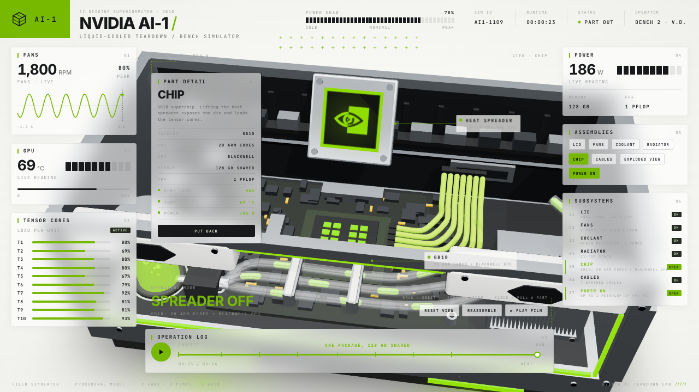
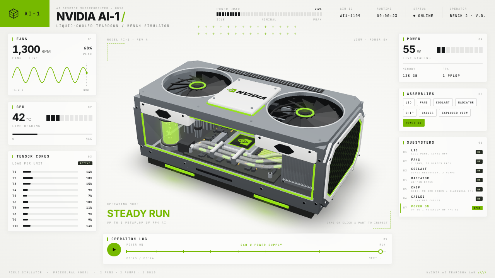
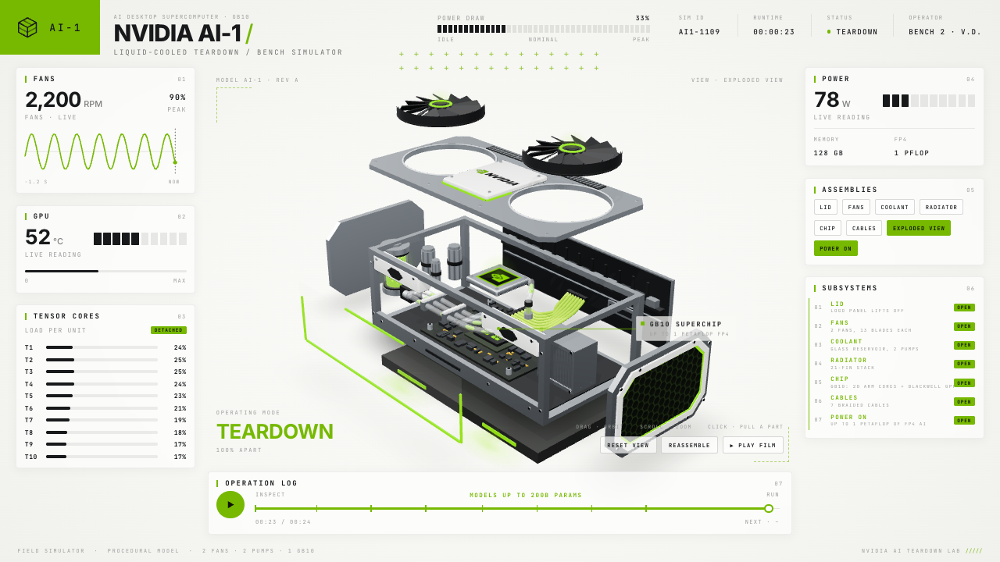

# NVIDIA AI-1 Teardown

An interactive 3D teardown simulator of a liquid-cooled desktop AI computer, running in the browser. Built with React and three.js; the model is generated entirely in code, with no 3D files or textures loaded from outside.



A 24-second teardown film plays on load. The moment you touch the scene, control passes to you: orbit the camera, click parts to pull them out of the machine, and inspect each one with live readings.

## Screenshots

| Film mode | Exploded view |
| --- | --- |
|  |  |

## Getting started

Requires Node.js 20.19 or newer.

```bash
npm install
npm run dev
```

Then open the address printed in the terminal (`http://localhost:5173` by default).

| Command | What it does |
| --- | --- |
| `npm run dev` | Starts the development server |
| `npm run build` | Type-checks and builds into `dist/` |
| `npm run preview` | Serves the built version locally |

## Controls

| Action | Result |
| --- | --- |
| Drag | Orbits the camera |
| Scroll | Zooms in and out |
| Double-click | Returns to the home view |
| Click a part | Pulls it out, focuses the camera on it and opens the detail panel |
| Click the focused part again | Puts it back |
| Click empty space | Clears the focus |

Six assemblies can be selected: lid, fans, coolant reservoir, radiator, chip and cables. Several can be out at the same time. When an inner part is pulled out, the lid and fans lift away on their own to clear the path.

The **ASSEMBLIES** buttons and **SUBSYSTEMS** rows on the right toggle the same parts; **EXPLODED VIEW** separates the whole machine and **POWER ON** switches the power. The **RESET VIEW**, **REASSEMBLE** and **PLAY FILM** buttons below the scene reset the camera, put everything back and return to the film. Click the timeline to jump to any moment of the film.

The gauges on the left (fan speed, GPU temperature, core loads, power draw) follow the current state of the machine. The values are simulated and not based on real measurements.

To open the film paused at a given second, add `?t=` to the address, for example `http://localhost:5173/?t=14.6`.

## How it works

- **One source of time.** In film mode everything is a pure function of the second `t`: part positions, camera, gauges and interface text are all computed from `src/timeline.ts`.
- **Two modes, smooth hand-off.** The timeline drives `film` mode and the user drives `inspect` mode. The two are blended every frame, so neither the camera nor the parts jump when you take over.
- **Procedural model.** The case, fans, pipes, radiator and mainboard are built from three.js primitive geometries; the honeycomb pattern, logo and light halos are drawn with `CanvasTexture`.
- **Callouts.** The labels attached to 3D points are plain DOM elements, projected onto the screen every frame.

```
src/
  timeline.ts        film beats, part channels, camera path, gauge values
  store.ts           zustand state: mode, pulled parts, focus
  live.ts            shared values updated every frame
  scene/
    Scene.tsx        canvas, lights, camera driver, mouse controls
    Machine.tsx      the machine's parts and their motion
    materials.ts     materials and drawn textures
  hud/Hud.tsx        gauges, buttons, detail panel
  styles.css         interface styles
```

**Stack:** Vite 8, React 19, TypeScript 7, three.js 0.187, @react-three/fiber 9, @react-three/drei 10, zustand 5.

## Notes

- The design is an independent piece inspired by the concept in [this video](https://x.com/0x_fokki/status/2119817143927587090).
- This is not an official NVIDIA product or project and has no affiliation with NVIDIA. The machine is fictional; the logo is a hand-drawn, stylised interpretation.
